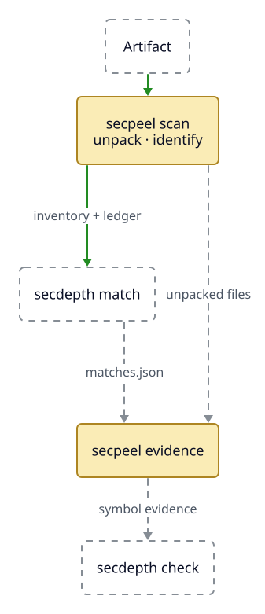

# secpeel (working name)

secpeel finds the open-source components inside compiled artifacts, such as executables, libraries, JARs, container images, firmware and installers, without source code or build files. It writes a component inventory that [secdepth](https://github.com/kobaltoxid/secdepth) matches against published advisories.

Detection is deterministic and never runs the artifact. A language model is used only later, in secdepth, to review flagged findings and write advice. The name is a placeholder.

secpeel does two jobs for secdepth: it builds the inventory, and after matching it looks for the vulnerable code itself.



Figure 1. The scan feeds secdepth's matcher, and the evidence step answers its matches. [D2 source](docs/diagrams/scan-flow.d2)

## Install

secpeel needs Python 3.10 or newer and no packages. Clone it and run it from the repository root:

```sh
git clone https://github.com/kobaltoxid/secpeel.git
cd secpeel
python3 -m secpeel scan path/to/artifact
```

Optional tools widen coverage when they are on `PATH`: [unblob](https://github.com/onekey-sec/unblob) or `7z` for SquashFS, ISO, MSI, CAB, 7z and RAR files, and the `zstd` command on Python versions older than 3.14. A missing tool is recorded in the results, not skipped silently.

## Scan an artifact

```sh
python3 -m secpeel scan app-image.tar --output app.inventory.json --cyclonedx app.cdx.json
```

The scan unpacks the artifact recursively by file content, identifies components, and writes:

- an inventory in secdepth's [inventory format](https://github.com/kobaltoxid/secdepth/blob/main/docs/inventory-format.md), and
- optionally, a CycloneDX 1.5 SBOM with the location of each component.

| Evidence | Components | Confidence |
| --- | --- | --- |
| Maven `pom.properties` | Maven artifacts; classes in the JAR are covered by it | exact |
| `MANIFEST.MF` without a POM | reported as `jar-manifest`, not matched | low |
| `package.json`, Python `METADATA`, .NET `deps.json` | npm, PyPI and NuGet packages | exact |
| Go build information, `cargo-auditable` data | Go modules and standard library, Rust crates | exact |
| dpkg and apk databases with `os-release` | Debian, Ubuntu and Alpine source packages | exact |
| Version strings in binaries | OpenSSL, zlib, curl, libpng, expat, BusyBox, bzip2, libssh2, OpenSSH, CPython, SQLite | high or medium |
| PE version resources | Windows product name and version | medium |

Distribution package data takes precedence over version strings for the same library, because version strings do not show backported fixes. A library name without its version string is not reported, since that usually means the file only links to it.

## Coverage ledger

Every file ends up in the inventory's coverage ledger as `unpacked`, `identified`, `unidentified`, `unpack-failed`, `skipped` or `tool-missing`, with a reason. `coverage.complete` is true only when nothing was left unexplained. Check the ledger before trusting a short component list: a small inventory with many `unidentified` entries is a gap, not a clean result.

## Find vulnerabilities with secdepth

From a secdepth checkout, match the inventory and draft the report:

```sh
python3 skills/secdepth/scripts/match.py app.inventory.json
python3 -m secpeel evidence app-image.tar --inventory app.inventory.json --matches matches.json
python3 skills/secdepth/scripts/check.py app.inventory.json matches.json --evidence evidence.json
python3 skills/secdepth/scripts/draft.py app.inventory.json matches.json checks.json
python3 skills/secdepth/scripts/render_report.py draft.json
```

Run the `secpeel evidence` command from this repository. It checks whether the classes or functions each advisory names are present in the component and which other code references them. When they are present, the finding becomes `conditional`; otherwise it stays `unknown` for review. Set `CFR_JAR` to a CFR decompiler JAR to include decompiled lines from referencing Java classes.

Native components are matched through NVD by CPE. Set `NVD_API_KEY` to raise NVD's rate limit.

## Limitations

- RPM databases are not parsed yet, and Syft is not integrated.
- Native checkers cover the libraries listed above. Stripped static binaries and libraries without checkers stay `unidentified`.
- Go binaries built before Go 1.18 and Go programs built as `(devel)` lack usable version data; the latter are reported with an unknown version.

## Development

Run the tests from the repository root with `python3 -m unittest discover -s tests`. The design is described in [docs/design.md](docs/design.md).
