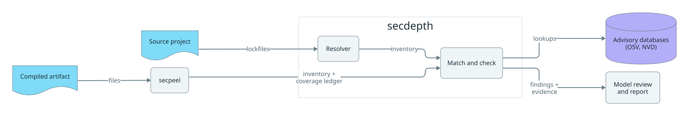

# secpeel and secdepth design

This page describes how secpeel and secdepth together find known vulnerabilities in compiled artifacts and source projects, with deterministic tools doing the detection and a language model only verifying and explaining the results.

## Goals and constraints

The pipeline answers two questions: which open-source components and versions an artifact or project contains, and which known vulnerabilities in those components can affect it.

- Detection is deterministic. Unpacking, identification, advisory lookup and version matching run without a language model, so the same input gives the same findings.
- Failures are visible. A file that could not be unpacked or identified is listed with a reason. A small inventory must never look like a clean result.
- Uncertainty is explicit. A component with an unknown version is reported as such instead of being matched against every advisory for that component.
- The model has a narrow role. It verifies findings the pipeline flagged, judges conditional reachability, and writes the summary and advice.
- The tools stay portable. The core uses the Python 3 standard library and runs from Codex, Claude Code or a local model. External tools are optional subprocesses.
- Known vulnerabilities only. Finding new vulnerabilities through fuzzing or static analysis is out of scope; see [Non-goals](#non-goals).

## Components

secpeel produces a component inventory from an artifact. secdepth produces the same inventory from source code, then matches it against advisories, checks exploitability and writes the report.

Figure 1. Both inputs meet at the inventory; only the final review uses a model. [D2 source](diagrams/design-context.d2)

| Component | Responsibility | Deterministic |
| --- | --- | --- |
| secpeel unpacker | Identifies files by magic bytes and unpacks containers recursively | Yes |
| secpeel identifiers | Turn evidence in each file into component records | Yes |
| Coverage ledger | Records the outcome for every file: identified, unidentified, unpack failed or skipped | Yes |
| secdepth resolver | Builds the full dependency tree of a source project from lockfiles | Yes |
| secdepth matcher | Looks up advisories for every component and matches version ranges | Yes |
| secdepth reachability checks | Collect presence, scope and call-site evidence for each match | Yes |
| Model review | Verifies flagged findings, resolves conditional reachability, writes advice | No |
| secdepth renderer | Writes `report.json` and `report.html` | Yes |

## Pipeline

The pipeline has seven stages. Every stage except the model review is deterministic, and each writes its output to disk, so a run can be inspected or resumed at any stage. Failures from the first two stages go into the coverage ledger, which travels with the inventory.

### 1. Unpack

The unpacker identifies each file by content, not by extension. It unpacks ZIP-based formats (JAR, WAR, APK), tar with gzip, bzip2 or xz, `ar` and Debian packages, cpio and container image layers with the standard library. When [unblob](https://github.com/onekey-sec/unblob) is installed, it handles firmware filesystems, installers and carved blobs. A container that neither can open is recorded in the ledger as `unpack-failed` with the reason.

### 2. Identify

Identifiers run on every unpacked file, in order of reliability:

1. Embedded package metadata gives exact names and versions: Maven `pom.properties` and `MANIFEST.MF`, `package.json`, Python `dist-info`, dpkg and apk databases, Go build information, `cargo-auditable` data, .NET `deps.json` and PE version resources. RPM databases and [Syft](https://github.com/anchore/syft) integration are not implemented yet.
2. Version strings identify native libraries such as OpenSSL, zlib, curl and SQLite. These checkers return a version or a version range with a confidence level.

Every record keeps its evidence: the file path inside the artifact, the identifier, the matched value and the confidence. A file no identifier claims is recorded as `unidentified`.

### 3. Hand off

secpeel writes the inventory: components as package URLs (PURLs) or CPEs with evidence, plus the coverage ledger. The format is versioned and also exported as a CycloneDX SBOM. secdepth's source resolver writes the same format.

### 4. Match

secdepth queries [OSV](https://google.github.io/osv.dev/) for every component and fetches each advisory's full record. It merges aliases so one vulnerability known by CVE, GHSA and distribution IDs becomes one finding, and it matches version ranges exactly. Operating system packages use the distribution's own advisories, which reflect backported fixes. NVD CPE matching is a fallback for native components without a package identity, because it is less precise. Withdrawn advisories are kept and marked as not affected.

A cached copy of the OSV export allows offline runs with a recorded data date.

### 5. Check reachability

For each match, secdepth collects evidence without a model:

- Scope: whether the component is a runtime, development or build dependency, and whether it ships in the published artifact.
- Call sites: imports and calls of the vulnerable package or function in the project's code, with file and line.
- Go: [govulncheck](https://go.dev/doc/tutorial/govulncheck) reports whether the vulnerable symbol is reachable from the program's entry points.
- Fix check: whether resolving the recommended upgrade removes the advisory.

For a compiled artifact, `secpeel evidence` checks whether the classes or functions an advisory names are present in the affected component, and lists the code that references them. It reads JAR contents and constant pools for Java and symbol tables for native code. CFR can decompile the referencing Java classes when it is installed. A finding without that evidence stays `unknown`.

This step is optional. The version match decides whether to upgrade; the evidence only helps prioritise mitigation. A hit does not prove reachability, and a miss does not clear a finding.

### 6. Review with a model

The model reads the draft findings and their evidence. It confirms or corrects reachability for findings marked `conditional` or `undetermined`, flags contradictions between evidence and verdict, and writes the summary and remediation advice. It cannot add findings without evidence from an earlier stage.

### 7. Report

secdepth's existing renderer writes the canonical `report.json` and the offline `report.html`.

## Reuse and build

| Area | Decision | Reason |
| --- | --- | --- |
| Unpacking | Standard library for common formats; unblob (MIT) or 7z when installed | unblob covers firmware and carving, and reports unknown chunks |
| Metadata identification | Own parsers; Syft (Apache-2.0) planned as an optional add-on | Own parsers keep the core dependency-free |
| Native library checkers | Own pattern files under a permissive license | cve-bin-tool has the best checker set but is GPL-3.0 and last released in 2024 |
| Advisory data | OSV API and its offline export; NVD CPE as a fallback | OSV covers language ecosystems and distributions, including backports |
| Prioritization | CISA KEV and EPSS as extra fields | Both are free, keyless feeds |
| Reachability | govulncheck for Go; own call-site search for other ecosystems; symbol and class presence for artifacts | No mature open-source call-graph tool exists for Java, npm, Python or .NET |
| Coverage ledger, evidence records, hand-off format | Build | No surveyed tool provides them |

Tool details come from a survey of the projects' repositories and documentation on 2026-11-19. API rate limits, OSV batch limits and the licenses of unblob's external extractors still need confirmation.

## Roadmap

- Code evidence for JavaScript and PHP components, following the Python approach: locate the package's files, look for the named definitions, and list the files that use the package.
- RPM database parsing, and Syft as an optional identifier.

## Non-goals

- Discovering unknown vulnerabilities by fuzzing, symbolic execution or broad static analysis.
- Running, exploiting or modifying the artifacts under analysis.
- Continuous monitoring. Each run is a one-off scan; a downstream tool such as Dependency-Track can store results over time.

## Decisions

These were agreed on 2026-11-19.

- unblob and Syft are optional. The core runs on the Python standard library, and the coverage ledger records anything skipped because an optional tool is missing.
- secdepth's deterministic core is built first, so the binary project plugs into a working matcher.
- secdepth's resolver supports npm first, then PyPI, Maven and Gradle, Go, Cargo and NuGet.

## Open decisions

- The license. Apache-2.0 would match the wrapped tools.
